# Ordera — Orders, stock and customers in one flow

[](https://github.com/mohammedayman5112/Ordera-Website/actions/workflows/ci.yml)

Ordera is a full-stack order and inventory management app for small shops: an **ASP.NET Core 10 / PostgreSQL** API with **JWT authentication, role-based access and real-time updates over SignalR**, and an **Angular 21** single-page app.

Customers place orders against live stock and follow them to delivery. Admins run the shop from a sales dashboard, manage the catalogue and users, and see every order the moment it arrives. Everything an admin does shows up live on the customer's screen.

The interesting parts are correctness and security: stock can never go negative (proved with parallel-request tests), a failed order never leaves a partial reservation behind, two people changing the same order cannot corrupt its history, and every permission is enforced by the API, not just hidden in the UI.

## Live demo

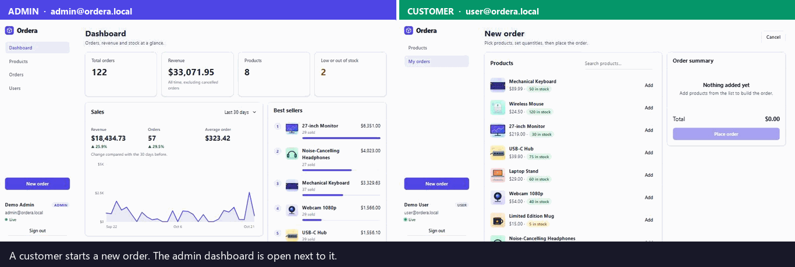

*Two browsers side by side: the admin (left) and the customer (right). Nothing is refreshed; every change arrives over SignalR.*

## Screenshots

| Sign in | Admin dashboard |
| --- | --- |
| 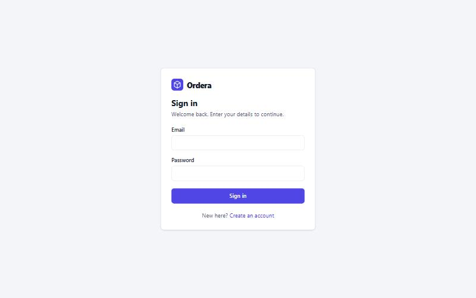 | 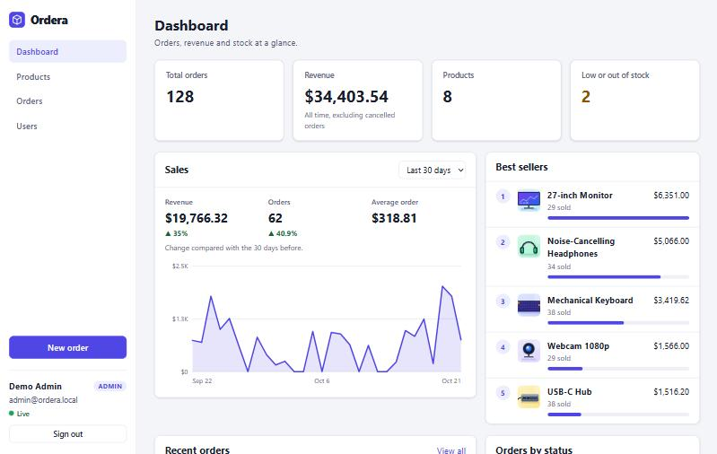 |

| Admin: all orders with customers | Admin: order details with an audit trail |
| --- | --- |
| 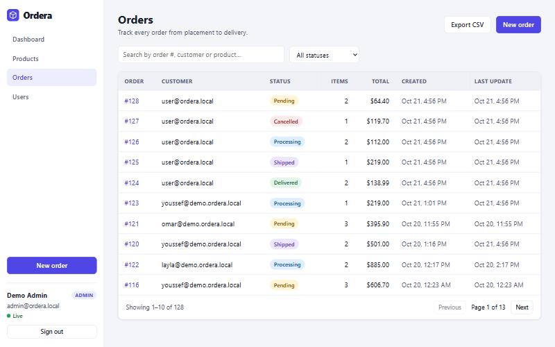 | 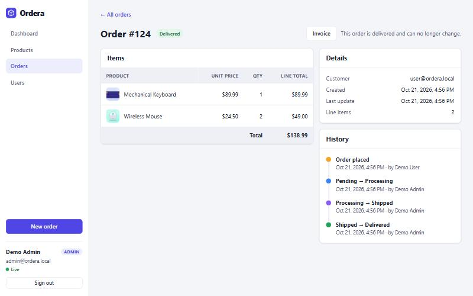 |

| Admin: catalogue management | Admin: users and roles |
| --- | --- |
| 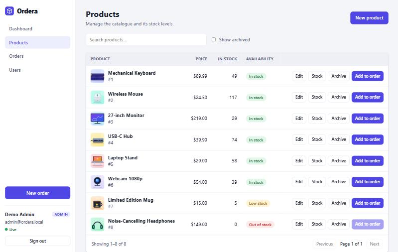 | 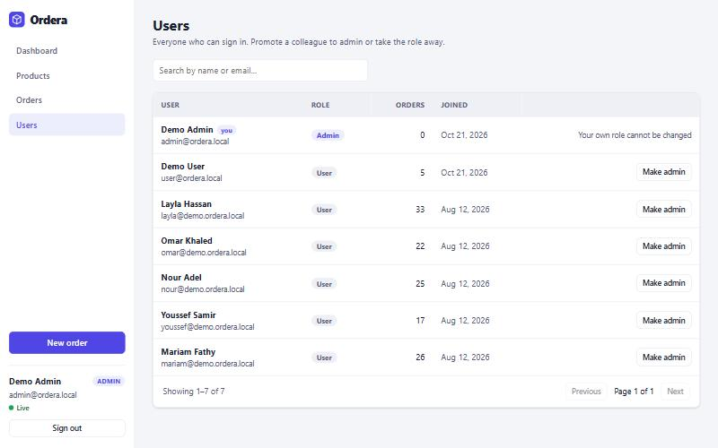 |

| Customer: visual catalogue | Admin: edit a product and its picture |
| --- | --- |
| 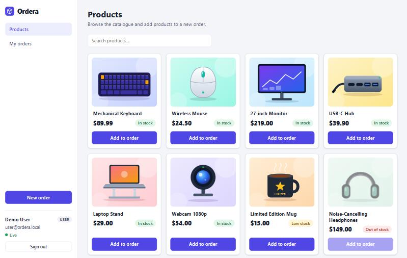 | 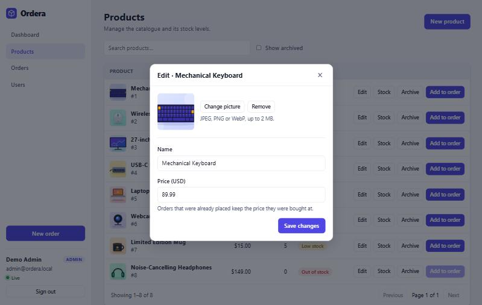 |

| Customer: "My orders" | Customer: new order |
| --- | --- |
| 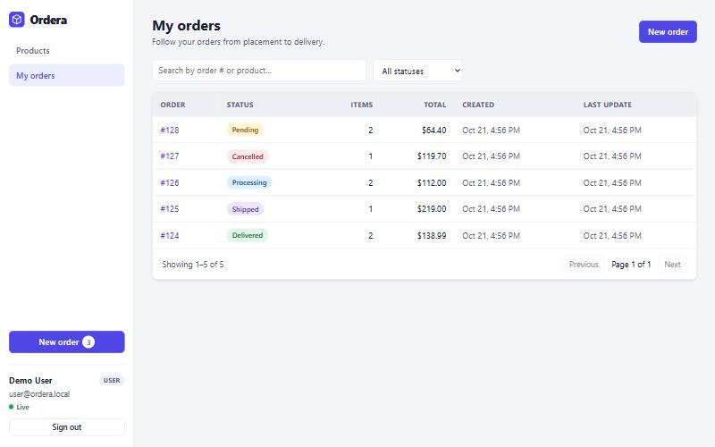 | 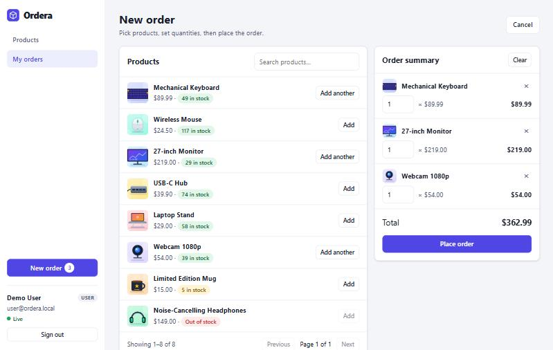 |

| Customer: live status update (toast, badge and timeline change without a reload) | Printable invoice |
| --- | --- |
| 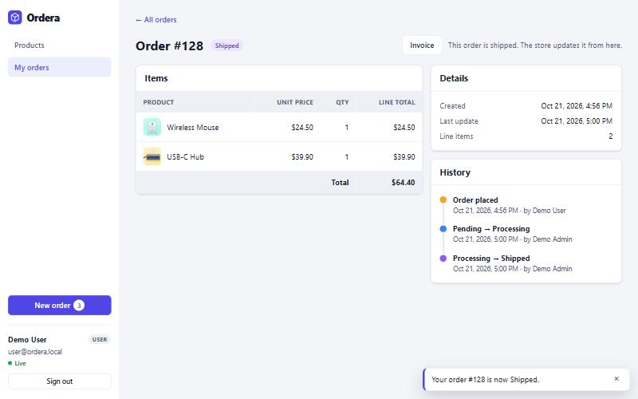 | 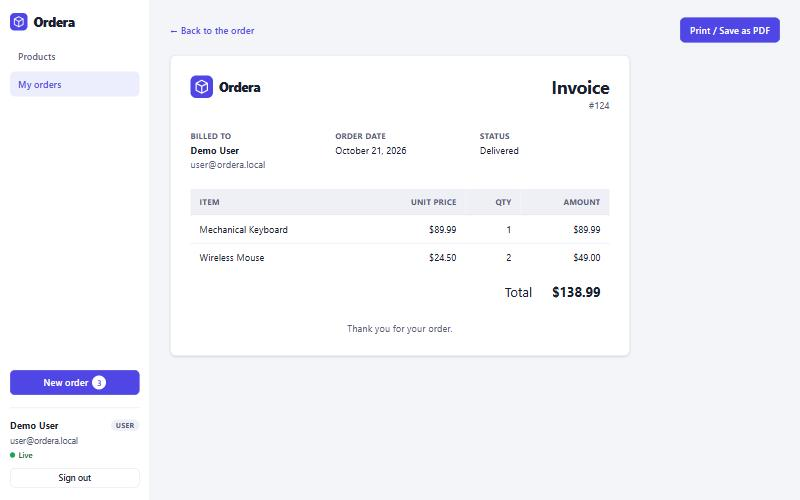 |

## Features

- **Live updates (SignalR / WebSockets)** — admins get a notification the moment an order is placed and their dashboard, order list and stock refresh by themselves; customers see their order change status in real time. A small "Live" indicator shows the connection state.
- **Sales analytics** — revenue, orders and average order value for the last 7, 30 or 90 days with the change against the previous period, a daily revenue chart (plain SVG, no chart library) and the best-selling products
- **Accounts and roles** — sign in, create an account, sign out; `Admin` and `User` roles change the navigation, pages and buttons (see the permission table)
- **Product pictures** — customers browse a **visual catalogue** (a card grid with picture, price and availability); admins upload, change or remove a picture (JPEG, PNG or WebP, up to 2 MB) when creating or editing a product. Pictures also appear in the order picker, the cart, order details and the dashboard's best sellers. A product without a picture gets a coloured initial tile. The demo data ships with eight illustrated sample products
- **Products** — search and pagination for everyone; admins create products, **edit name and price**, add/remove stock or set an exact quantity, and **archive / restore** products (archived products disappear for customers and cannot be ordered)
- **Orders** — filter by status, search by order number, product or (admins) customer, paginated list, filters kept in the URL, **CSV export** of the current filter
- **New order** — pick products, set quantities, the order summary persists across reloads, clear messages when stock ran out
- **Order details** — line items, totals and a status timeline that records **who made each change**. Admins take any valid step (Pending → Processing → Shipped → Delivered, cancel before shipping); customers can cancel their own order. Cancelling returns the stock
- **Printable invoice** — a clean invoice page for each order; "Print / Save as PDF" uses the browser's print dialog
- **User management** — admins list every account with its order count and promote or demote users (never themselves)
- Responsive layout, light and dark theme (follows the OS), keyboard-accessible dialogs

## Roles and permissions

| Action | Anonymous | User | Admin |
| --- | :---: | :---: | :---: |
| Sign in / create an account | ✅ | — | — |
| Browse products | ❌ | ✅ | ✅ |
| Create, edit, archive products; change stock | ❌ | ❌ | ✅ |
| Place an order | ❌ | ✅ | ✅ |
| List and open orders | ❌ | own orders only | all orders |
| Cancel an order | ❌ | own orders only | any order |
| Move an order to Processing / Shipped / Delivered | ❌ | ❌ | ✅ |
| Dashboard, analytics, CSV export | ❌ | ❌ | ✅ |
| Manage users and roles | ❌ | ❌ | ✅ |
| Live "new order" notifications | ❌ | ❌ | ✅ |
| Live updates for their own orders | ❌ | ✅ | ✅ |

Someone else's order is reported as **404**, not 403, so its existence is not revealed. Orders created before accounts existed have no owner and are only visible to admins.

### Demo accounts and demo data (development only)

When the API runs in the `Development` environment (`dotnet run`, Visual Studio or `docker compose up`) it creates two accounts from `appsettings.Development.json`:

| Role | Email | Password |
| --- | --- | --- |
| Admin | `admin@ordera.local` | `Admin123!` |
| User | `user@ordera.local` | `User123!` |

On a fresh database it also creates five demo customers and about two months of order history, so the dashboard and charts have something to show. The demo customers cannot sign in. Turn the demo data off with `Seed:DemoData=false`.

These credentials and the signing key in that file exist for local development only. In any other environment no demo accounts are created and you must provide your own signing key (see below).

## Tech stack

| Layer | Technologies |
| --- | --- |
| Frontend | Angular 21 (standalone components, signals, zoneless, lazy-loaded routes), TypeScript (strict), RxJS, SignalR client, typed reactive forms, functional guards and interceptors, SCSS design tokens, Vitest |
| Backend | ASP.NET Core 10, Entity Framework Core 10, Npgsql, SignalR, JWT bearer authentication, policy-based authorization, rate limiting, health checks, OpenAPI, ProblemDetails (RFC 7807) |
| Database | PostgreSQL 16, EF Core migrations, check constraints, unique and composite indexes |
| Testing | xUnit, Testcontainers (a real PostgreSQL in Docker), `WebApplicationFactory`, SignalR client, Vitest |
| DevOps | Docker, Docker Compose, nginx (static hosting, `/api` and WebSocket reverse proxy), multi-stage builds, GitHub Actions |

## Architecture

```
┌────────────┐   /api/*   ┌──────────────┐    EF Core    ┌────────────┐
│  Angular   │ ─────────► │ ASP.NET Core │ ────────────► │ PostgreSQL │
│  (nginx)   │ ◄───────── │  Web API     │ ◄──────────── │            │
└─────┬──────┘  JSON/HTTP └──────┬───────┘               └────────────┘
      │   /hubs/orders (WebSocket)│  SignalR groups: admins, user:{id}
      └───────────────────────────┘
   :4200      Bearer JWT       :8080                          :5433
```

In Docker the browser only talks to nginx; nginx serves the Angular bundle and proxies `/api` and the WebSocket endpoint `/hubs` to the API container, so no CORS setup is needed.
In development the Angular dev server does the same through `proxy.conf.js`.

## Engineering highlights

**Real time**

- The API pushes events through a SignalR hub. **Admins** join an `admins` group and receive every order event; each user also joins a group of their own, so a customer only ever hears about **their own** orders. Pushing is best-effort: a failed push is logged and never fails the request that caused it.
- Browsers cannot set an `Authorization` header on a WebSocket, so the token travels in the query string, and only on the hub path.
- The Angular `RealtimeService` loads the SignalR client lazily (it is its own chunk), reconnects automatically, refreshes pages after a reconnect so no event is missed, and does not tell you about changes you made yourself.

**Security**

- **Secure by default** — a fallback authorization policy requires a signed-in user for every endpoint; only the sign-in and sign-up endpoints opt out with `[AllowAnonymous]`. Admin-only endpoints use an `AdminOnly` policy.
- **Passwords** are hashed with ASP.NET Core's PBKDF2 `PasswordHasher` (with automatic rehash on login). Unknown emails and wrong passwords return the same message and cost about the same time, so accounts cannot be enumerated.
- **JWT** — short-lived HS256 tokens validated for issuer, audience, lifetime, signature and algorithm. The signing key is never committed to `appsettings.json`: the API refuses to start without a key of at least 32 bytes.
- **No privilege escalation** — sign-up always creates a `User`; any `role` sent by the client is ignored.
- **Rate limiting** — sign-in and sign-up allow 10 attempts per minute per client and answer `429` with `Retry-After`. Behind nginx the real client address is taken from `X-Forwarded-For`.
- **Object-level authorization** — order ownership is checked on read and on status changes, not only on list queries.
- **CSV injection protection** — exported cells that start with `=`, `+`, `-` or `@` are neutralised, because a customer controls their own email address.
- **Safe uploads** — a picture is accepted only if its first bytes say it is a JPEG, PNG or WebP (the file name and the declared content type are not trusted). SVG is refused because it can carry scripts. Files are stored under a random name, never the uploaded one, so there is no path traversal, and they are served with `X-Content-Type-Options: nosniff`. Oversized uploads get `413`.
- **Open-redirect protection** — the `?returnUrl=` after sign-in only accepts in-app paths.

**Backend**

- **Atomic stock reservation** — each order line runs one conditional `UPDATE ... WHERE AvailableQuantity >= @qty` inside a transaction. There is no read-then-write race; if any line fails, the whole order rolls back.
- **Deadlock avoidance** — order lines are merged per product and always locked in ascending product-id order.
- **Status state machine** — transitions are defined once in `OrderStatusRules`. The update is conditional on the status that was read, so concurrent changes surface as a `409 Conflict` instead of silently overwriting each other. Every change is written to an append-only history table together with the person who made it.
- **Cancellation restocks** — returning stock happens in the same transaction as the status change.
- **Price snapshots** — an order line stores the price at purchase time, so editing a product never rewrites history.
- **Caching** — in-memory cache with single-flight loading (`Lazy<Task<T>>`) so a cold key is loaded once, failures are never cached, and writes invalidate the affected keys.
- **Database constraints** — `CHECK (AvailableQuantity >= 0)`, a unique index on the user email, composite indexes for the list queries, `RESTRICT` on deletes.
- **Safe migrations** — new columns are additive; for example existing products stay active when the archive flag is added (verified by upgrading a copy of an older database).
- **Consistent errors** — validation, not-found, forbidden and conflict responses use `ProblemDetails`; stock conflicts include `productId`, `requested` and `available` so clients can react precisely.
- **Literal search** — `%` and `_` typed by a user are escaped and matched literally (an integration test caught that the provider needs the escape character passed explicitly).
- **Picture storage behind an interface** — `IProductImageStore` hides where files live; the default writes to a Docker volume (so pictures survive container restarts). Because file names are random and never change, pictures are served with `Cache-Control: public, max-age=31536000, immutable`; replacing a picture creates a new URL and deletes the old file.
- **Observability basics** — a `/health` endpoint checks the database connection.

**Frontend**

- Standalone components with `OnPush`, **signals** for state and `toSignal`/`toObservable` where RxJS is the better fit; no NgModules.
- **Auth architecture** — an `AuthService` holding the session, functional `authGuard` / `adminGuard` / `guestGuard`, and an interceptor that attaches the token only to `/api` calls and ends the session on `401`. The shell layout is a routed parent, so the sign-in pages render without the sidebar.
- **Lazy-loaded routes** — pages load on demand; the initial bundle is about 85 kB over the wire.
- **Functional HTTP interceptor** turns any failed request into a readable toast; pages that render the error themselves opt out through an `HttpContextToken`.
- **URL as state** — page, search and filters live in the query string, so views can be bookmarked and the back button behaves.
- Typed API layer whose models mirror the backend DTOs; typed reactive forms with custom validators.
- Native `<dialog>` modal (focus trap and Esc handling for free), print stylesheet for the invoice.

**Testing**

- **131 backend tests** against a real PostgreSQL container: the full authorization matrix, ownership rules, the order workflow, audit trail, archive and price-snapshot rules, analytics, CSV export, user management, picture upload rules (type sniffing, size limit, SVG refusal, replacement and cleanup), SignalR delivery (who hears what), and **concurrency tests** — 30 parallel orders for 5 units sell exactly 5, opposite-order multi-product orders never deadlock, 12 parallel status changes apply once, 10 parallel cancellations restock once.
- **166 frontend unit tests** covering the auth service, guards and interceptors, the real-time service (with a fake hub), the chart, forms, the picture upload UI, role-based UI and the API client.

## Getting started

### Option 1 — everything in Docker

```bash
docker compose up --build
```

| Service | URL |
| --- | --- |
| Web app | http://localhost:4200 |
| Swagger UI | http://localhost:8080/swagger |
| PostgreSQL | localhost:5433 (`postgres` / `postgres`) |

The database is migrated and seeded with sample products, the demo accounts and demo orders on first start. Sign in with one of the accounts above.

To run a clean demo next to your normal data, use a separate project name (its own database volume): `docker compose -p ordera-demo up --build`, and remove it with `docker compose -p ordera-demo down -v`.

### Option 2 — local development

Requirements: .NET 10 SDK, Node.js 22+, Docker (for PostgreSQL).

```bash
# 1. database
docker compose up -d db

# 2. API (http://localhost:52195, Swagger at /swagger)
dotnet run

# 3. Angular app with hot reload (http://localhost:4200, proxies /api and /hubs to the API)
cd client
npm install
npm start
```

Point the dev proxy at a different API address with `API_URL`, for example `API_URL=http://localhost:8080 npm start`.

Swagger UI has an **Authorize** button: call `POST /api/auth/login`, copy the `accessToken` and paste it there.

### Configuration outside development

| Setting | Purpose |
| --- | --- |
| `Jwt__Key` | **Required.** Signing key, at least 32 bytes of random data (for example `openssl rand -base64 48`) |
| `Jwt__Issuer`, `Jwt__Audience`, `Jwt__ExpiryMinutes` | Token settings (defaults: `OrderApi`, `Ordera`, 60) |
| `ConnectionStrings__Default` | PostgreSQL connection string |
| `Cors__AllowedOrigins__0` | Origin allowed to call the API directly (not needed behind the nginx proxy) |
| `RateLimiting__AuthPermitLimit` | Sign-in / sign-up attempts per minute per client (default 10) |
| `Storage__ProductImagesPath` | Folder where uploaded product pictures are stored (Docker: `/data/product-images`, a named volume; default `App_Data/product-images`) |
| `Storage__MaxImageBytes` | Largest accepted picture in bytes (default 2 MB) |
| `Database__MigrateOnStartup`, `Database__SeedOnStartup` | Apply migrations / create sample data on start (default: on in Development only) |
| `Seed__DemoData` | Also create demo customers and order history (only used when seeding is on) |

### Tests

```bash
# Backend (needs Docker running: the tests start a PostgreSQL container)
dotnet test OrderApi.slnx

# Angular unit tests
cd client
npm test

# API collection (needs the API running; set baseUrl to its address)
npx newman run postman/OrderApi.postman_collection.json --env-var baseUrl=http://localhost:8080
```

The Postman collection starts with an **Auth** folder that signs in, stores the token, and checks the 401 / 403 rules before the Products, Orders and Cancel-flow folders run. GitHub Actions runs the backend tests, the Angular tests and builds, and the Docker images on every push.

## API overview

| Method | Endpoint | Access | Description |
| --- | --- | --- | --- |
| `POST` | `/api/auth/login` | public | Sign in, returns an access token (`401` for wrong credentials) |
| `POST` | `/api/auth/register` | public | Create a regular account (`409` if the email exists) |
| `GET` | `/api/auth/me` | signed in | Profile of the current user |
| `GET` | `/api/products?page&pageSize&search&includeArchived` | signed in | List products (`includeArchived` only works for admins) |
| `GET` | `/api/products/{id}` | signed in | Get a product (archived ones: admins only) |
| `POST` | `/api/products` | admin | Create a product |
| `PUT` | `/api/products/{id}` | admin | Change name and price |
| `POST` | `/api/products/{id}/archive`, `/restore` | admin | Hide a product from customers / bring it back |
| `PUT` | `/api/products/{id}/image` | admin | Upload or replace the picture (`multipart/form-data`, field `file`; `400` for a wrong type, `413` over the limit) |
| `DELETE` | `/api/products/{id}/image` | admin | Remove the picture |
| `GET` | `/api/images/products/{file}`, `/api/images/seed/{file}` | public | The pictures themselves (immutable cache headers) |
| `PUT` | `/api/products/{id}/stock` | admin | Set the stock to an exact quantity |
| `POST` | `/api/products/{id}/stock/adjust` | admin | Add or remove stock (`409` if it would go below zero) |
| `GET` | `/api/orders?status&search&page&pageSize` | signed in | List orders (own orders, or all for admins) |
| `GET` | `/api/orders/export?status&search` | admin | Download the matching orders as CSV |
| `POST` | `/api/orders` | signed in | Place an order (`409` when stock is insufficient) |
| `GET` | `/api/orders/{id}` | owner or admin | Order details with items and status history |
| `PUT` | `/api/orders/{id}/status` | owner (cancel only) or admin | Change the status (`409` for an invalid transition) |
| `GET` | `/api/dashboard/summary` | admin | All-time figures, status breakdown, recent orders, low stock |
| `GET` | `/api/dashboard/analytics?days=30` | admin | Sales for the last N days vs the previous period, best sellers |
| `GET` | `/api/users?page&pageSize&search` | admin | List users with their order counts |
| `PUT` | `/api/users/{id}/role` | admin | Promote or demote a user (`409` for yourself) |
| `GET` | `/health` | public | Database connectivity check |
| `WS` | `/hubs/orders` | signed in | SignalR hub: `orderCreated` (admins), `orderStatusChanged` (admins and the owner) |

A Postman collection is available in [`postman/`](postman/OrderApi.postman_collection.json).

## Project structure

```
OrderApi/
├── Auth/                   JWT options, token service, policies, OpenAPI bearer scheme
├── Hubs/                   SignalR hub
├── Storage/                product picture store, magic-byte image sniffer
├── wwwroot/seed-images/    illustrations for the sample products
├── Controllers/  Services/  Domain/  Data/  Dtos/  Caching/  Migrations/   ASP.NET Core API
├── tests/OrderApi.Tests/   xUnit tests (Testcontainers, WebApplicationFactory, SignalR client)
├── client/                                                                 Angular app
│   ├── src/app/core/       typed API clients, models, auth, real-time service, cart and toasts
│   ├── src/app/layout/     shell with the role-aware navigation
│   ├── src/app/shared/     brand logo, status badge, pagination, search box, modal, revenue chart, toasts
│   ├── src/app/features/   auth, dashboard, products, orders (list, details, invoice, new order), users
│   ├── Dockerfile  nginx.conf
├── .github/workflows/      CI
├── docker-compose.yml      db + api + web
├── docs/screenshots/
└── postman/
```

## Design notes and trade-offs

- **One API instance.** SignalR groups and the in-memory cache and rate limiter live inside the process. Running several instances needs a SignalR backplane (for example Redis) and a shared cache and limiter.
- **Roles live in the token.** A role change takes effect when the user's current token expires (60 minutes by default) or they sign in again. Revoking a token earlier would need a refresh-token or denylist mechanism.
- **The token is kept in `localStorage`.** That is simple and works with the API on the same origin, but it is readable by any script on the page. A hardened setup would use short-lived access tokens with a refresh token in an `HttpOnly` cookie and a strict Content-Security-Policy.
- **UI checks are a convenience.** The Angular guards and hidden buttons only improve the experience; the API enforces every rule independently.
- **Pictures live on local disk (a Docker volume).** That is fine for one instance. Several instances need shared storage, which means implementing `IProductImageStore` on object storage such as S3 or Azure Blob. Pictures are stored as uploaded: there is no resizing or thumbnail generation, hence the 2 MB limit.
- **Analytics are computed on request.** That is plenty for a small shop; a large one would pre-aggregate daily totals.

## Ideas for next steps

- Refresh tokens (`HttpOnly` cookie) and token revocation
- Arabic / RTL interface
- End-to-end tests (Playwright) for the order flow
- Shipping address, payment provider and email notifications on status changes
